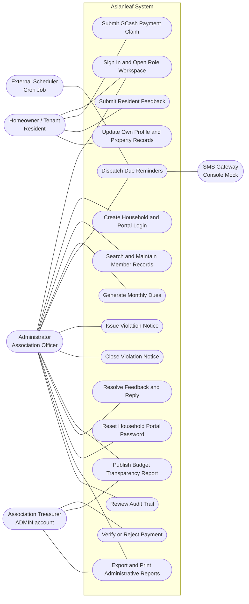
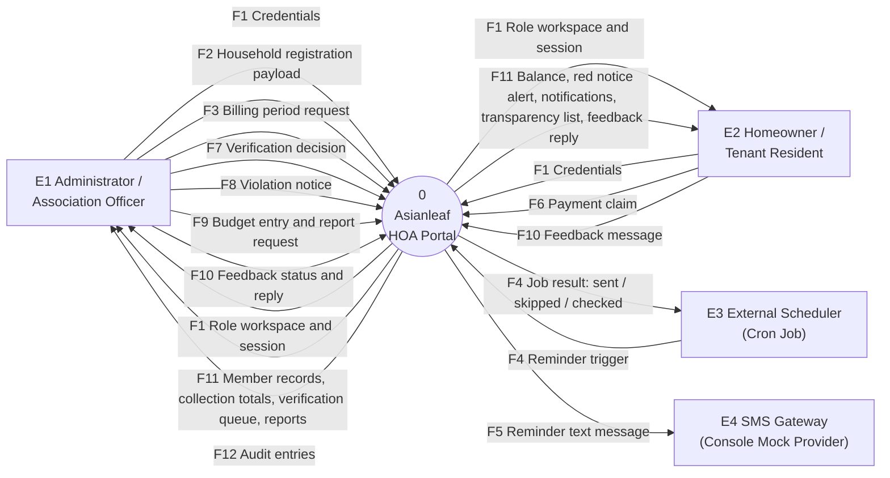
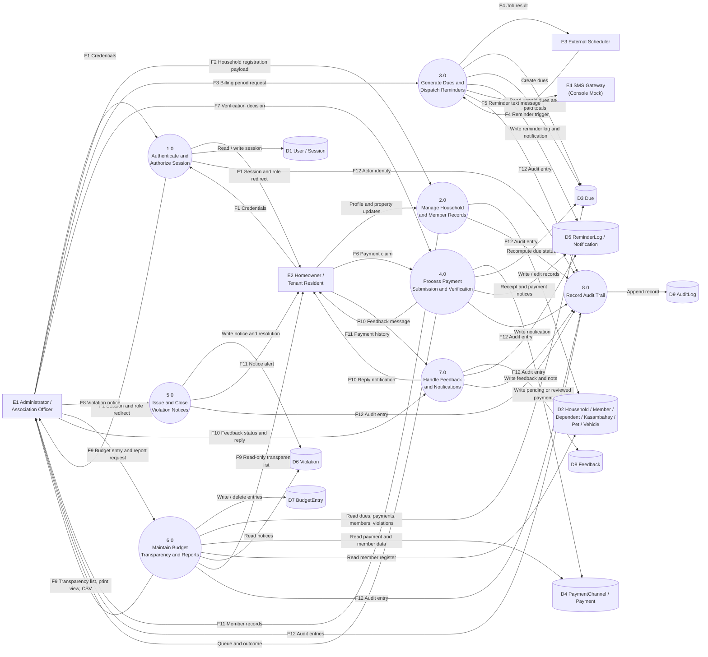
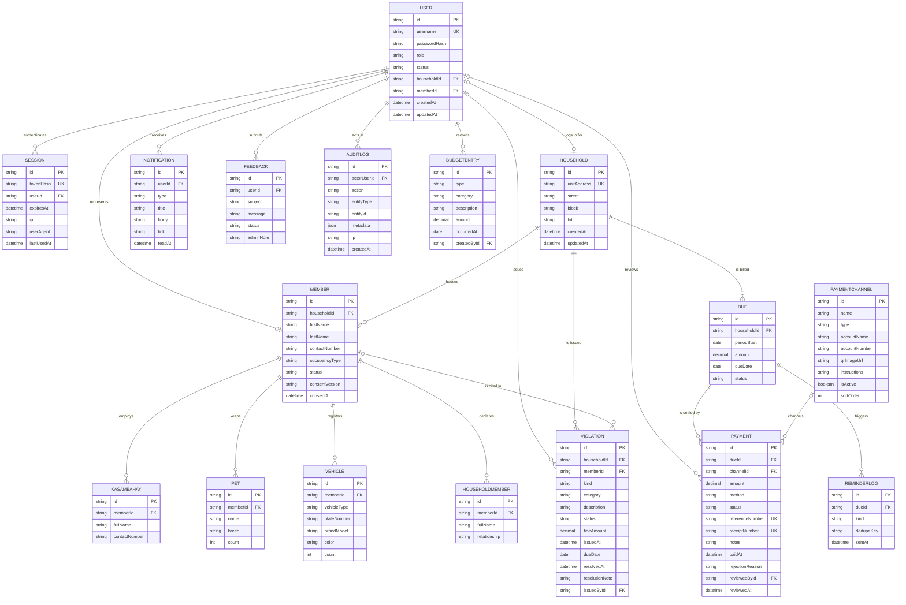
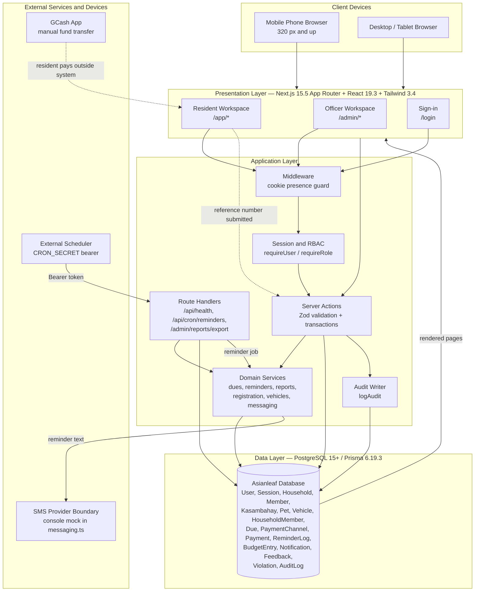

# Outcomes-Based Assessment — Week 10
## System Design Documentation & Progress Report 8 (Draft of Chapter 3)

### Header Metadata

- **Proposed Study Title:** *Design and Development of a Web-Based Homeowners Association Management and Financial Transparency System for the Asian Leaf Homeowners Association, General Trias, Cavite*
- **Proposed System Name:** Asianleaf

> **Scope note used throughout this document (no invented features):** Asianleaf is a server-rendered web portal with two roles (`ADMIN`, `HOMEOWNER`). Payments are **GCash only**, submitted by reference number and **manually verified** by an officer — there is no payment gateway integration, no receipt upload, and no official QR asset bundled. Outbound SMS passes through a **console-mock provider boundary**. Automation is driven by an **external scheduler** calling a bearer-protected cron endpoint. Billing is a fixed **PHP 1,500.00** monthly due on the **5th**.

---

# Part 1: Requirements Specification

## 1. Requirements Table

| ID | Requirement Statement | Type | Source or Stakeholder | Priority | Acceptance Evidence |
|---|---|---|---|---|---|
| **FR-01** | The system shall allow an Administrator to create a household, primary resident, dependents, kasambahay, pets, vehicles, and a homeowner portal login in a **single database transaction** through `/admin/members/new`. | Functional | HOA Board / Association Office | High | Submitting the Add Member wizard creates `Household`, `Member`, `User` (role `HOMEOWNER`, status `ACTIVE`), plus any `HouseholdMember`, `Kasambahay`, `Pet`, `Vehicle` rows; an in-app `GENERAL` notification "Your household login is ready" is created; the browser is redirected to `/admin/members/[id]?notice=Member added…`. A thrown `P2002` returns "That username, contact number or unit is already in use." |
| **FR-02** | The system shall reject duplicate username, duplicate 11-digit contact number, and duplicate unit (case-insensitive `unitAddress` or identical `block`+`lot`) when a household is created or a unit is edited. | Functional | Association Office | High | Username collision renders the field error "That username is already taken."; contact collision renders "A member already uses this contact number."; unit collision renders "A household with this street, block and lot already exists." / "Another household already uses that unit." Enforced by `User.username @unique`, `Household.unitAddress @unique`, `Household @@unique([block, lot])` and pre-checks. |
| **FR-03** | The system shall generate one monthly due of **PHP 1,500.00**, due on the **5th** of the billing month, for every household, and shall be **idempotent** (re-running for the same month creates no additional dues). | Functional | Treasurer / Board | High | `/admin/dues` then Generate dues for a chosen `YYYY-MM`. Second run returns "Dues for YYYY-MM were already generated." because `prisma.due.createMany({ skipDuplicates: true })` is backed by `Due @@unique([householdId, periodStart])`. |
| **FR-04** | The system shall automatically dispatch due reminders at the one-month, one-week, one-day, and overdue thresholds, creating an **in-app notification** and an **outbound SMS record**, and shall de-duplicate repeated runs (overdue reminders repeating at most once per ISO week). | Functional | Treasurer / Board | High | Running reminders twice returns "No new reminders to send (N already sent)"; `ReminderLog` rows use `@@unique([dueId, dedupeKey])` with keys `ONE_MONTH` / `ONE_WEEK` / `ONE_DAY` / `OVERDUE-YYYY-Www`. Each first-time send creates a `DUE_REMINDER` or `DUE_OVERDUE` notification linked to `/app/payments` and calls `sendSms()` with the household's oldest member contact number. |
| **FR-05** | The system shall allow a Homeowner to submit a GCash payment claim (amount, reference number, payment date, optional notes) against an open due, recording it as `PENDING` **without reducing the outstanding balance**. | Functional | Homeowner / Resident | High | `/app/payments` submission creates `Payment` with `status = PENDING`, `method` copied from the channel type, and redirects to `/app/payments?submitted=1`. Overpayment is blocked ("The amount cannot be more than the remaining balance of X."); duplicate reference is blocked by `Payment.referenceNumber @unique` ("That reference number was already submitted."); closed or waived dues are blocked ("That billing period is no longer open."). |
| **FR-06** | The system shall allow an Administrator to verify or reject a pending payment; approval shall generate a unique receipt number, mark the payment `PAID`, re-evaluate the due to `PAID` only when verified totals meet the due amount, and notify the homeowner; rejection shall require a 3 to 300 character reason and notify the homeowner. | Functional | Treasurer | High | `/admin/payments` then Approve produces `RCPT-<year>-<6 hex>` and "Payment approved. Receipt ..."; the `Due` becomes `PAID` when the sum of `PAID` payments is at least the due amount, otherwise remains `UNPAID`. Reject returns "Give a short reason for rejecting the payment." when the reason is missing, sets `status = REJECTED` with `rejectionReason`, and creates a "Payment not verified" notification. Non-pending rows are refused ("Only pending payments can be approved/rejected."). |
| **FR-07** | The system shall allow an Administrator to issue a household violation notice classified as **Warning only** or **Needs payment** (with positive fine amount and due date), display open notices to the resident as a **red dashboard alert**, and later mark the notice `RESOLVED` or `DISMISSED`. | Functional | Board / Security Committee | High | `/admin/violations` create form; validation messages "Enter the amount the resident needs to pay." and "Choose the payment due date." for `PAYMENT_REQUIRED`. Homeowner `/app/dashboard` shows a danger-tone alert titled "Warning: category" or "Payment required: category" linking to `/app/violations`; `/app/violations` lists household notices; closing sets `status` and `resolvedAt`. |
| **FR-08** | The system shall let an Administrator record income and expense budget entries and expose them to homeowners as a **read-only transparency report**. | Functional | Treasurer / Homeowners | High | `/admin/budget` create/delete actions write `BudgetEntry` (`type`, `category`, `description`, `amount`, `occurredAt`); `/app/budget` renders the same entries and monthly totals with no mutation controls (latest 100 rows). |
| **FR-09** | The system shall allow a Homeowner to submit feedback (optional subject, message of 5 to 2,000 characters) and allow an Administrator to set status `NEW` to `READ` to `RESOLVED` with an optional admin note that triggers a `FEEDBACK_REPLY` notification to the author. | Functional | Homeowner / Board | Medium | `/app/feedback` submit redirects to `/app/feedback?submitted=1`; `/admin/feedback` shows unread/open counts; status or note change creates a notification titled "Your feedback was resolved" or "Feedback updated" linking to `/app/feedback`. |
| **FR-10** | The system shall authenticate users by **unique username and password**, permit sign-in only for accounts with status `ACTIVE`, and route `ADMIN` to `/admin/dashboard` and `HOMEOWNER` to `/app/dashboard`. | Functional | All users | High | `/login` with seeded accounts (`admin`, `treasurer`, `maria.santos`, ...). Invalid credentials return "Incorrect username or password."; `DISABLED` returns "This account has been disabled. Contact the association office."; success sets the `asialeaf_session` cookie and redirects by role. There is no public registration route. |
| **FR-11** | The system shall allow an Administrator to reset a household's portal password from the member record, and the reset shall **invalidate every existing session** for that login. | Functional | Association Office / Homeowner | Medium | `/admin/members/[id]` then Portal login card. Password must be 8 to 72 characters with lowercase, uppercase, and a digit; mismatch returns "The passwords do not match."; success returns "Password reset for username. Existing sessions were signed out." because the transaction deletes all `Session` rows for that `userId`. |
| **FR-12** | The system shall allow a Homeowner to update their own contact number and manage their own dependents, kasambahay, pets, and vehicles, while **unit details remain administrator-controlled**. | Functional | Homeowner | Medium | `/app/profile` actions validate the 11-digit contact and name pattern; every add/remove writes only to the resolver's own `memberId` (ownership enforced by `findFirst({ where: { id, memberId } })`); street/block/lot editing is absent from the homeowner UI but present for admins. |
| **FR-13** | The system shall produce date-filterable administrative reports (unpaid dues, inactive members, open violations, payments) that can be **printed** and **exported as CSV**. | Functional | Board / Treasurer | Medium | `/admin/reports` renders four report tables with `from`/`to` filters and print CSS; `/admin/reports/export?report=...` returns `Content-Type: text/csv; charset=utf-8`, a `Content-Disposition` attachment filename `asianleaf-<report>-<date>.csv`, a UTF-8 BOM for Excel, and `Cache-Control: no-store`. Non-admin or anonymous access returns HTTP 401. |
| **FR-14** | The system shall record every privileged mutation in an audit trail containing actor, action, entity type, entity ID, JSON metadata, and timestamp, and display the most recent 100 entries at `/admin/audit`. | Functional | Board / Auditor | Medium | Audit rows written for `MEMBER_CREATED`, `MEMBER_UPDATED`, `HOUSEHOLD_UNIT_UPDATED`, `PASSWORD_RESET`, `MEMBER_DELETED`, `DUES_GENERATED`, `DUE_WAIVED`, `REMINDERS_SENT`, `PAYMENT_APPROVED`, `PAYMENT_REJECTED`, `VIOLATION_ISSUED`, `VIOLATION_RESOLVED`, `VIOLATION_DISMISSED`, `BUDGET_ENTRY_CREATED`, `BUDGET_ENTRY_DELETED`, `FEEDBACK_UPDATED`, `PROFILE_CONTACT_UPDATED`; audit write failures are caught and logged so they never break the business action. |
| **NFR-01** | **Security (credentials).** Passwords shall be stored only as bcrypt hashes with cost factor 12; session tokens shall be 32 random bytes stored as SHA-256 hashes; the browser cookie shall be `HttpOnly`, `SameSite=Lax`, `Secure` in production, path `/`, with a 14-day expiry. | Nonfunctional | Security / Data Privacy | High | `bcrypt.hash(password, 12)` in member creation and password reset; `crypto.randomBytes(32).toString("base64url")` token stored as `Session.tokenHash`; cookie options in `createSession`. No plaintext password or raw token exists in the database. |
| **NFR-02** | **Security (authorization).** Every protected page and mutation shall re-verify the server-side session (hash lookup, expiry, and `status === "ACTIVE"`) and enforce the caller's role, independent of the middleware cookie presence check. | Nonfunctional | Security | High | `middleware.ts` only checks cookie presence for `/admin/:path*`, `/app/:path*`, `/design`; `requireRole()` re-loads the session and redirects mismatched roles to their own dashboard; every `actions.ts` begins with `requireRole("ADMIN")` or `requireRole("HOMEOWNER")`; `/admin/reports/export` separately returns 401 for non-admins. |
| **NFR-03** | **Usability (mobile responsiveness).** All resident and officer screens shall be usable from a 320 px-wide viewport upward, using a mobile-first single-column layout that expands to multi-column at `sm`/`lg` breakpoints, with an off-canvas navigation drawer on small screens. | Nonfunctional | Homeowners / Officers | High | Tailwind `grid-cols-2 lg:grid-cols-4` dashboard tiles, `grid-cols-4` resident action tiles with `text-xs`, collapsible `AdminShell` sidebar with menu/close controls, table wrappers for horizontal overflow, and viewport meta tags from the App Router root layout. |
| **NFR-04** | **Performance.** Interactive pages shall return rendered HTML within 3 seconds on the seeded dataset (5 households, 15 dues, 10 payments) and every collection query shall be index-backed or explicitly bounded by a `take` limit. | Nonfunctional | All users | Medium | Aggregations run in parallel via `Promise.all` (admin dashboard issues 21 concurrent counts/aggregates); session lookup wrapped in React `cache()` for one DB read per request; indexed fields (`@@index([status, dueDate])`, `@@index([userId, readAt])`, `@@index([householdId, status])`, `@@index([createdAt])`); bounded reads (`take: 100` audit/budget/feedback, `take: 1000/2000` reports). |
| **NFR-05** | **Data integrity.** Monetary values shall be stored as `Decimal(10,2)`; referential actions shall be explicit (cascade for dependent records, restrict for posted payments and budget entries, set-null for optional reviewers/issuers); and multi-table writes shall be atomic. | Nonfunctional | Treasurer / Auditor | High | `Due.amount`, `Payment.amount`, `BudgetEntry.amount`, `Violation.fineAmount` typed `@db.Decimal(10,2)`; `Payment.due` uses `onDelete: Restrict`; `BudgetEntry.createdBy` uses `Restrict`; household/member creation, payment approval, and reminder dispatch each run inside `prisma.$transaction`; enums constrain `DueStatus`, `PaymentStatus`, `ViolationStatus`, `BudgetType`, `FeedbackStatus`. |
| **NFR-06** | **Operability.** The system shall expose a database health endpoint and a secret-protected reminder job endpoint that fails closed in production. | Nonfunctional | Operations | Medium | `GET /api/health` returns `{ ok: true, database: "up", counts: {...} }` or HTTP 503 `{ ok: false, database: "down" }`; `GET /api/cron/reminders` requires `Authorization: Bearer $CRON_SECRET` (or `?secret=`), returns 401 `Unauthorized` otherwise, returns HTTP 500 `{ ok: false }` on job failure, and treats an unset secret as development-only. |
| **NFR-07** | **Maintainability and input validity.** All form input shall be validated server-side with Zod before persistence, and user-facing errors shall identify the offending field rather than fail silently. | Nonfunctional | Development Team | Medium | Zod schemas in every `actions.ts`; member wizard returns `fieldErrors` map plus `vehicleErrors` by row index and scrolls the first invalid field into view; HTML `pattern` attributes mirror server rules (`NAME_INPUT_PATTERN`); `npm run lint`, `npm run typecheck`, and `npm run build` pass. |

## 2. Requirements Review

The requirement statements above are **specific** because each names a concrete screen, actor, entity, state transition, or numeric threshold (PHP 1,500.00, the 5th, 5 to 2,000 characters, 8 to 72 characters, cost factor 12, 14-day expiry, 100 audit rows, 320 px) rather than a vague capability. They are **testable** because every acceptance evidence cell cites an observable system state, namely a redirect URL with a notice string, a persisted enum value, a generated receipt format, a CSV `Content-Type`, or an HTTP status code, that a reviewer can reproduce from the seeded accounts. They are **within scope** because each traces to code that exists in `src/app`, `src/lib`, or `prisma/schema.prisma`; explicitly excluded and therefore not claimed are online payment-gateway capture, receipt image upload, self-service password recovery, outbound SMS carrier delivery, and multi-role treasurer privileges. They are **supported by evidence** drawn from the schema constraints, server actions, and page components rather than from aspirational documentation, and this document deliberately overrides the README's stale `/forgot-password` and `/app/change-password` references. Finally, they are **free from conflicting terms**: one vocabulary is used throughout, namely *household* (the billed unit), *member* (a resident record), *due* (a billing period obligation), *payment* (a GCash claim), *violation* (a notice), *feedback*, *budget entry*, *notification*, and *audit log*; moreover, the terms "treasurer" and "administrator" are not treated as separate roles, since the schema defines only `ADMIN` and `HOMEOWNER` and the seeded treasurer account carries `role = ADMIN`.

---

# Part 2: Use Case Model

## 1. Actors Table

| Actor | Role and Access | Main Use Cases | Related Requirement IDs |
|---|---|---|---|
| **Administrator / Association Officer** | `Role = ADMIN`. Full access to `/admin/dashboard`, `/admin/members`, `/admin/members/new`, `/admin/members/[id]`, `/admin/dues`, `/admin/payments`, `/admin/violations`, `/admin/budget`, `/admin/reports`, `/admin/feedback`, `/admin/audit`. No `householdId` or `memberId` link. Every mutation passes `requireRole("ADMIN")`. | Create household and login; Search and edit member records; Generate dues; Run reminders; Verify or reject payments; Issue and close violations; Record budget entries; Export and print reports; Answer feedback; Reset a portal password; Review the audit log. | FR-01, FR-02, FR-03, FR-04, FR-06, FR-07, FR-08, FR-09, FR-10, FR-11, FR-13, FR-14, NFR-01, NFR-02 |
| **Association Treasurer** | Operationally distinct officer, but **not a separate RBAC role**: authenticated through an `ADMIN` account (seeded username `treasurer`, `role = ADMIN`). Holds the GCash account details and performs manual verification. | Verify GCash references against the HOA account; approve or reject payments; record income and expense entries; review collection totals. | FR-06, FR-08, FR-13, NFR-05 |
| **Homeowner / Tenant Resident** | `Role = HOMEOWNER`, linked one-to-one to a `Household` and, where applicable, a `Member`. Access limited to `/app/dashboard`, `/app/payments`, `/app/violations`, `/app/profile`, `/app/budget`, `/app/feedback`. Unit details and billing are read-only. Sign-in requires `UserStatus = ACTIVE`. | View balance and notices; Submit a GCash payment claim; Read violation notices; Update contact and household property records; Read the transparency report; Submit feedback and read replies. | FR-05, FR-07, FR-08, FR-09, FR-10, FR-12, NFR-03, NFR-04 |
| **External Scheduler (Cron Job)** | Non-human actor holding `CRON_SECRET`. Calls `GET /api/cron/reminders` with a bearer token; has no UI and no session. | Trigger the due-reminder job without operator intervention. | FR-04, NFR-06 |
| **SMS Gateway (Console Mock Provider)** | External system boundary implemented by `src/lib/messaging.ts`, which logs the message and returns `{ delivered: false, provider: "console" }`. Swap-in point for a real carrier. | Receive outbound reminder text addressed to the resident's 11-digit contact number. | FR-04 |

## 2. Use Case Diagram



**ASCII fallback**

```text
        Administrator                Treasurer            Homeowner/Tenant        Scheduler        SMS Gateway
              |                          |                       |                   |                |
              |                          |                       |                   |                |
   +----------+--------------------------+-----------------------+-------------------+----------+     |
   |                                     ASIANLEAF SYSTEM                                      |     |
   |                                                                                          |     |
   |  (UC-01) Sign In and Open Role Workspace  <------ both roles                            |     |
   |  (UC-02) Create Household and Portal Login                                               |     |
   |  (UC-03) Search and Maintain Member Records                                              |     |
   |  (UC-04) Generate Monthly Dues                                                           |     |
   |  (UC-05) Dispatch Due Reminders  -------------------------------------- triggers ---------+     |
   |  (UC-06) Submit GCash Payment Claim  <------ resident                                    |     |
   |  (UC-07) Verify or Reject Payment  <------ treasurer                                     |     |
   |  (UC-08) Issue Violation Notice                                                          |     |
   |  (UC-09) Close Violation Notice                                                          |     |
   |  (UC-10) Publish Budget Transparency Report <---- treasurer + homeowner (read-only)      |     |
   |  (UC-11) Submit Resident Feedback <------ resident                                       |     |
   |  (UC-12) Resolve Feedback and Reply                                                      |     |
   |  (UC-13) Update Own Profile and Property Records <------ resident                        |     |
   |  (UC-14) Reset Household Portal Password                                                 |     |
   |  (UC-15) Export and Print Administrative Reports  <---- treasurer                        |     |
   |  (UC-16) Review Audit Trail                                                              |     |
   |                                                                                          |     |
   +------------------------------------------------------------------------------------+     |
                                                                                        |     |
                                          (UC-05) sends reminder text -----------------+-----+--> SMS
```

## 3. Use Case Description Table

| Use Case | Primary Actor | Precondition | Main Flow | Alternative or Exception | Postcondition |
|---|---|---|---|---|---|
| **UC-02 Create Household and Portal Login** | Administrator | Administrator is signed in with `role = ADMIN`; selected username, contact number, and unit are free. | 1. Opens `/admin/members/new`. 2. Enters unique username and password (8+ chars, upper, lower, digit) with confirmation. 3. Enters first/last name, 11-digit contact, and owner/tenant occupancy. 4. Selects street (or *Other street*), block, and lot; a live preview composes `Blk 2 Lot 14, Sampaguita St.`. 5. Adds dependents with relationship, kasambahay with optional contacts, pets, and vehicles. 6. Submits. | Username taken gives a field error; contact taken gives a field error; unit taken gives a block field error; a name with digits returns `NAME_ERROR`; duplicate plate numbers return "Each vehicle plate number can only be listed once."; a `P2002` at commit returns a generic duplicate message and leaves no partial rows. | Household, primary member (with `consentVersion` and `consentAt`), `ACTIVE` homeowner login, dependents, kasambahay, pets, vehicles, and a welcome `GENERAL` notification exist atomically; `MEMBER_CREATED` is audited; the admin lands on the new member record. |
| **UC-04 / UC-05 Generate Dues and Dispatch Reminders** | Administrator (manual) or External Scheduler (automated) | Households exist; billing month is a valid `YYYY-MM`; for the cron path, `CRON_SECRET` is configured. | 1. Opens `/admin/dues` and selects a month, or calls `GET /api/cron/reminders` with a bearer token. 2. System creates one `Due` per household at PHP 1,500.00 with `dueDate` on the 5th. 3. System evaluates unpaid dues within 30 days, computes the remaining balance, and classifies the reminder threshold. 4. System writes a `ReminderLog` and an in-app notification, then calls `sendSms`. | Re-running generation returns "already generated"; re-running reminders returns "No new reminders to send"; already fully paid or waived dues are skipped; an ineligible threshold yields no reminder; an unauthorized cron call returns 401; a job exception returns 500 and is logged. | One due per household per billing period; at most one reminder per threshold per due (weekly for overdue); residents see the notification on `/app/dashboard`; `DUES_GENERATED` and `REMINDERS_SENT` are audited. |
| **UC-06 / UC-07 Submit and Verify GCash Payment** | Homeowner (submit) then Treasurer/Administrator (verify) | Homeowner login is linked to a household; an `UNPAID` due with a positive balance exists; an active `GCASH` payment channel exists. | 1. Homeowner opens `/app/payments`, reads HOA GCash account details, sends the amount in the GCash app. 2. Submits amount, reference number, date, and optional notes. 3. Payment is stored `PENDING`; balance is unchanged. 4. Treasurer opens `/admin/payments`, checks the reference against the GCash account. 5. Approves: system generates `RCPT-<year>-<hex>`, marks `PAID`, recomputes the due, and notifies the homeowner. | Amount exceeds balance, so it is rejected before save; duplicate reference returns "That reference number was already submitted."; a due already `PAID` or `WAIVED` returns "That billing period is no longer open."; treasurer rejects with a reason, producing `REJECTED` plus a notification; approving a non-pending row is refused. | Verified payment carries a receipt number and reviewer identity; the due becomes `PAID` only when verified totals cover the amount; the homeowner's dashboard and payment history reflect the outcome; `PAYMENT_APPROVED` or `PAYMENT_REJECTED` is audited. |
| **UC-08 / UC-09 Issue and Close Violation Notice** | Administrator | Administrator is signed in; the target household exists. | 1. Opens `/admin/violations`. 2. Selects household and optionally a resident. 3. Chooses Warning only or Needs payment, enters category, description, issue date, and, when payment is required, a positive fine and due date. 4. Submits. 5. Resident sees the red alert on `/app/dashboard` and the entry on `/app/violations`. 6. Administrator later marks `RESOLVED` or `DISMISSED`. | Missing category, description, or date returns "Complete the household, category, description and date."; a missing fine or due date for a payment-required notice returns a specific message; a member not in the selected household returns "Choose a resident from the selected household." | Notice is `OPEN` with issuer recorded; the resident dashboard shows the alert; closing stamps `resolvedAt` and clears the dashboard alert; `VIOLATION_ISSUED`, `VIOLATION_RESOLVED`, or `VIOLATION_DISMISSED` is audited. |
| **UC-10 / UC-15 Publish Transparency Data and Export Reports** | Treasurer/Administrator; Homeowner reads only | Administrator signed in; at least one budget entry may exist; for export, the requester is an `ADMIN` session. | 1. Administrator opens `/admin/budget`, adds income or expense entries with category, description, amount, and date. 2. System recomputes monthly totals. 3. Homeowner opens `/app/budget` and sees the read-only list and totals. 4. Administrator opens `/admin/reports`, sets an optional `from`/`to` range for unpaid dues, inactive members, open violations, or payments. 5. Prints the page or downloads CSV. | Invalid entry data produces an error redirect without persistence; an unknown report key returns HTTP 400; anonymous or non-admin export returns HTTP 401; an empty date range returns all rows up to the query cap. | Budget entries persist with creator attribution and audit rows; homeowners see identical figures with no edit controls; CSV downloads as `asianleaf-<report>-<date>.csv` with a UTF-8 BOM and is not cached. |
| **UC-01 / UC-14 Sign In and Reset Portal Password** | Homeowner, Administrator, then Administrator (reset) | Account exists with `UserStatus = ACTIVE`; for a reset, a portal login is linked to the member record. | 1. User opens `/login`, enters username and password. 2. System lowercases and validates the username, compares the bcrypt hash, checks `DISABLED`, then creates a 14-day session and sets the `HttpOnly` cookie. 3. Administrator opens the member record's Portal login card, enters a new password twice. 4. System validates strength, hashes at cost 12, updates the hash, and deletes all sessions for that user. | Unknown username or bad password returns the identical "Incorrect username or password." message; `DISABLED` returns the disabled-account message; an expired or inactive session redirects to `/login`; a weak or mismatched reset password returns a field-level message; a member without a login returns "No portal login is linked to this household." | Redirect to the role dashboard; reset invalidates prior sessions so the resident must sign in again with the new password; `PASSWORD_RESET` is audited. |

---

# Part 3: Process and Data Models

## A. Context Diagram and Data Flow Diagram (DFD)

### DFD Elements Table

| DFD Element | Name | Description | Related Requirement IDs |
|---|---|---|---|
| **External Entity** | E1 - Administrator / Association Officer | Human officer using the `/admin` workspace for records, billing, verification, notices, budget, reports, feedback, and audit review. | FR-01, FR-02, FR-03, FR-06, FR-07, FR-08, FR-09, FR-11, FR-13, FR-14 |
| **External Entity** | E2 - Homeowner / Tenant Resident | Human resident using the `/app` workspace for balance, payments, notices, profile, transparency, and feedback. | FR-05, FR-07, FR-08, FR-10, FR-12 |
| **External Entity** | E3 - External Scheduler (Cron Job) | Automation client presenting `CRON_SECRET` to trigger reminders. | FR-04, NFR-06 |
| **External Entity** | E4 - SMS Gateway (Console Mock Provider) | Outbound text-message boundary in `src/lib/messaging.ts`. | FR-04 |
| **Process 1.0** | Authenticate and Authorize Session | Validates credentials, creates/destroys hashed sessions, resolves the cached session user, enforces role and `ACTIVE` status. | FR-10, FR-11, NFR-01, NFR-02 |
| **Process 2.0** | Manage Household and Member Records | Creates and maintains households, members, dependents, kasambahay, pets, and vehicles; rejects duplicates; writes audit rows. | FR-01, FR-02, FR-12, NFR-05, NFR-07, FR-14 |
| **Process 3.0** | Generate Dues and Dispatch Reminders | Bills every household per period and evaluates threshold-based, de-duplicated reminders. | FR-03, FR-04, NFR-06 |
| **Process 4.0** | Process Payment Submission and Verification | Captures pending GCash claims, validates amount against balance, and applies approve/reject decisions. | FR-05, FR-06, NFR-05, NFR-07 |
| **Process 5.0** | Issue and Close Violation Notices | Records warning or payment-required notices against households/residents and closes them. | FR-07, FR-14 |
| **Process 6.0** | Maintain Budget Transparency and Reports | Stores income/expense entries, computes monthly totals, builds and exports report tables. | FR-08, FR-13 |
| **Process 7.0** | Handle Feedback and Notifications | Captures resident feedback, applies status and admin notes, and fans out in-app notifications. | FR-04, FR-06, FR-09 |
| **Process 8.0** | Record Audit Trail | Persists actor/action/entity/metadata records for privileged mutations and serves the latest 100. | FR-14, NFR-05 |
| **Data Flow** | F1 - Credentials and session cookie | Username/password in; `asialeaf_session` cookie and role redirect out. | FR-10, NFR-01 |
| **Data Flow** | F2 - Household registration payload | Wizard fields plus `payload` JSON for dependents, kasambahay, pets, vehicles. | FR-01, FR-02 |
| **Data Flow** | F3 - Billing period request | `month` in `YYYY-MM` from the officer UI. | FR-03 |
| **Data Flow** | F4 - Reminder trigger and job result | Bearer token in; `{ ok, sent, skipped, checked }` out. | FR-04, NFR-06 |
| **Data Flow** | F5 - Reminder text message | Contact number plus composed balance sentence to the messaging boundary. | FR-04 |
| **Data Flow** | F6 - Payment claim | `dueId`, `channelId`, `amount`, `referenceNumber`, `paidAt`, `notes`. | FR-05 |
| **Data Flow** | F7 - Verification decision | `paymentId` plus approve/reject and rejection reason. | FR-06 |
| **Data Flow** | F8 - Violation notice | Household, optional member, kind, category, description, issued date, fine, due date, resolution status. | FR-07 |
| **Data Flow** | F9 - Budget and report request | Entry fields; report key plus `from`/`to`; CSV stream or print view out. | FR-08, FR-13 |
| **Data Flow** | F10 - Feedback and reply | Subject/message in; status/admin note out; notification back to author. | FR-09 |
| **Data Flow** | F11 - Dashboard and notice view | Balance, red violation alert, latest three notifications, transparency list. | FR-05, FR-07, FR-08, FR-09 |
| **Data Flow** | F12 - Audit entry | Actor, action, entity type, entity ID, metadata, timestamp. | FR-14 |
| **Data Store** | D1 - `User`, `Session` | Credentials, role, status, household/member linkage, hashed session tokens with expiry and client metadata. | FR-10, FR-11, NFR-01, NFR-02 |
| **Data Store** | D2 - `Household`, `Member`, `HouseholdMember`, `Kasambahay`, `Pet`, `Vehicle` | Unit identity and resident/property register. | FR-01, FR-02, FR-12 |
| **Data Store** | D3 - `Due` | One obligation row per household per billing period with status and due date. | FR-03, FR-04 |
| **Data Store** | D4 - `PaymentChannel`, `Payment` | HOA GCash display details plus submitted claims, receipt numbers, reviewer, and rejection reasons. | FR-05, FR-06 |
| **Data Store** | D5 - `ReminderLog`, `Notification` | De-duplication keys per due and per-user in-app messages with read state. | FR-04, FR-06, FR-09 |
| **Data Store** | D6 - `Violation` | Notice register with kind, fine, status, issuer, and resolution data. | FR-07 |
| **Data Store** | D7 - `BudgetEntry` | Income/expense ledger used for the transparency report. | FR-08, FR-13 |
| **Data Store** | D8 - `Feedback` | Resident message, status, and admin note. | FR-09 |
| **Data Store** | D9 - `AuditLog` | Append-only privileged action history. | FR-14 |

### Context Diagram (Level 0)



### Detailed DFD (Level 1)



**Balancing statement.** Every Level 0 flow appears at Level 1 exactly once as an external boundary flow: F1 at 1.0 (both roles), F2 at 2.0, F3 at 3.0, F4 at 3.0 (both directions), F5 leaving 3.0, F6 at 4.0, F7 at 4.0, F8 at 5.0, F9 at 6.0 (to both officer and resident), F10 at 7.0 (in from resident, in from officer, out to resident), F11 out of 2.0/4.0/5.0/6.0, and F12 out of 8.0. Conversely, no Level 1 external flow is absent from Level 0; the additional arrows at Level 1 are internal (process-to-datastore) connections only, which is the permitted refinement.

## B. Entity-Relationship Diagram (ERD)

### Entities Table

| Entity | Primary Key | Important Attributes | Related Entity and Cardinality |
|---|---|---|---|
| **User** | `id` (cuid) | `username` (unique), `passwordHash`, `role` (`ADMIN`/`HOMEOWNER`), `status` (`PENDING`/`ACTIVE`/`DISABLED`), `householdId` (unique, nullable), `memberId` (unique, nullable), timestamps | One `User` to zero-or-one `Household`; zero-or-one `Member`; many `Session`, `Notification`, `Feedback`, `AuditLog`, `BudgetEntry`; one-to-many `Payment` as reviewer; one-to-many `Violation` as issuer |
| **Session** | `id` (cuid) | `tokenHash` (unique), `expiresAt`, `ip`, `userAgent`, `lastUsedAt` | Many `Session` to one `User` (`onDelete: Cascade`); indexed on `userId` and `expiresAt` |
| **Household** | `id` (cuid) | `unitAddress` (unique), `street`, `block`, `lot`, unique `(block, lot)` | One `Household` to many `Member`, `Due`, `Violation`; zero-or-one `User` account |
| **Member** | `id` (cuid) | `firstName`, `lastName`, `contactNumber` (11 digits), `occupancyType` (`OWNER_OCCUPIED`/`TENANT`), `status` (`ACTIVE`/`INACTIVE`), `consentVersion`, `consentAt` | Many `Member` to one `Household` (cascade); zero-or-one `User`; many `Kasambahay`, `Pet`, `Vehicle`, `HouseholdMember`, `Violation` |
| **Kasambahay** | `id` (cuid) | `fullName`, `contactNumber` (nullable, 11 digits) | Many to one `Member` (cascade) |
| **Pet** | `id` (cuid) | `name`, `breed` (default "Not specified"), `count` (default 1) | Many to one `Member` (cascade) |
| **Vehicle** | `id` (cuid) | `vehicleType` (default "OTHER"), `plateNumber`, `brandModel`, `color`, `count`; partial unique `(memberId, plateNumber)` excluding `N/A` | Many to one `Member` (cascade) |
| **HouseholdMember** | `id` (cuid) | `fullName`, `relationship` (nullable) | Many to one `Member` (cascade) |
| **Due** | `id` (cuid) | `periodStart` (date), `amount` `Decimal(10,2)`, `dueDate` (date), `status` (`UNPAID`/`PAID`/`WAIVED`), unique `(householdId, periodStart)` | Many `Due` to one `Household` (cascade); one-to-many `Payment` and `ReminderLog` |
| **PaymentChannel** | `id` (cuid) | `name`, `type` (`GCASH`/`BANK_TRANSFER`/`EWALLET`/`CASH`), `accountName`, `accountNumber`, `qrImageUrl`, `instructions`, `isActive`, `sortOrder` | One `PaymentChannel` to many `Payment` (set null on delete) |
| **Payment** | `id` (cuid) | `amount` `Decimal(10,2)`, `method`, `status` (`PENDING`/`PAID`/`REJECTED`), `referenceNumber` (unique), `receiptNumber` (unique, nullable), `notes`, `paidAt`, `rejectionReason`, `reviewedById`, `reviewedAt` | Many `Payment` to one `Due` (`onDelete: Restrict`); to one `PaymentChannel` (set null); to one `User` reviewer (set null) |
| **ReminderLog** | `id` (cuid) | `kind` (`ONE_MONTH`/`ONE_WEEK`/`ONE_DAY`/`OVERDUE`), `dedupeKey`, `sentAt`, unique `(dueId, dedupeKey)` | Many to one `Due` (cascade) |
| **BudgetEntry** | `id` (cuid) | `type` (`INCOME`/`EXPENSE`), `category`, `description`, `amount` `Decimal(10,2)`, `occurredAt` (date), `createdById` | Many to one `User` creator (`onDelete: Restrict`) |
| **Notification** | `id` (cuid) | `type` (`DUE_REMINDER`/`DUE_OVERDUE`/`PAYMENT_RECEIVED`/`FEEDBACK_REPLY`/`GENERAL`), `title`, `body`, `link`, `readAt` | Many to one `User` (cascade); indexed `(userId, readAt)` |
| **Feedback** | `id` (cuid) | `subject` (nullable), `message`, `status` (`NEW`/`READ`/`RESOLVED`), `adminNote` | Many to one `User` (cascade); indexed on `status` |
| **Violation** | `id` (cuid) | `kind` (`WARNING`/`PAYMENT_REQUIRED`), `category`, `description`, `status` (`OPEN`/`RESOLVED`/`DISMISSED`), `fineAmount`, `issuedAt`, `dueDate`, `resolvedAt`, `resolutionNote`, `issuedById` | Many to one `Household` (cascade); zero-or-one `Member` (set null); to one `User` issuer (set null) |
| **AuditLog** | `id` (cuid) | `action`, `entityType`, `entityId`, `metadata` (JSON), `ip`, `createdAt` | Many to one `User` actor (set null); indexed `(entityType, entityId)` and `(createdAt)` |

### ERD Diagram



---

# Part 4: System Architecture and Data Gathering Procedure

## A. System Architecture

### Architecture Table

| Component or Layer | Responsibility | Technology or Service if Known | Connected Components |
|---|---|---|---|
| **Presentation Layer - Officer Workspace** | Renders the admin dashboard (collection rate, six-month trend, section tiles), member directory with search and filters, member record tabs (overview, household, kasambahay, pets, vehicles, violations), dues console, payment queue, violation forms, budget editor, report tables with print CSS, feedback inbox, and audit log. | Next.js 15.5 App Router server components, React 19.3, Tailwind CSS 3.4 design tokens, custom `components/ui` set, `AdminShell` responsive sidebar with theme toggle | Application Layer (server actions and queries); Data Layer via Prisma; browser device |
| **Presentation Layer - Resident Workspace** | Renders the greeting, balance hero with "Pay now", red violation alert, four-tile action grid, updates list, GCash instructions, payment history, profile forms, read-only transparency report, and feedback thread. | Same Next.js/React/Tailwind stack with mobile-first grids (`grid-cols-4` tiles, `sm`/`lg` expansion), `HomeownerShell`, persisted dark-mode toggle | Application Layer; Data Layer; browser device |
| **Application Layer - Session and Access Control** | Validates credentials with bcrypt, issues 32-byte tokens stored as SHA-256 hashes, sets the `HttpOnly` `asialeaf_session` cookie for 14 days, resolves the session user per request with React `cache()`, enforces `ACTIVE` status and role. | `src/lib/auth.ts`, `src/lib/session-cookie.ts`, `src/middleware.ts`, `bcryptjs` 3.0.3, Node `crypto` | Presentation Layer; `User` and `Session` tables; all protected actions |
| **Application Layer - Domain Services** | Encapsulates billing period math, reminder threshold and de-duplication logic, report construction and CSV serialization, validation schemas, messaging boundary, vehicle rules, money and date formatting, Manila-aware date helpers. | `src/lib/dues.ts`, `reminders.ts`, `reports.ts`, `registration.ts`, `locations.ts`, `vehicles.ts`, `vehicle-store.ts`, `messaging.ts`, `money.ts`, `dates.ts`, `constants.ts`, `zod` 4.6.7 | Presentation Layer; Data Layer; External services |
| **Application Layer - Mutations** | Executes privileged writes as Next.js server actions guarded by `requireRole`, wrapped in Prisma transactions where atomicity matters, followed by `revalidatePath` cache invalidation and `logAudit`. | Next.js server actions (`"use server"`) in `src/app/**/actions.ts` | Data Layer; Presentation Layer revalidation; `AuditLog` |
| **Application Layer - API and Job Endpoints** | Serves `GET /api/health` (database liveness and counts), `GET /api/cron/reminders` (bearer-protected reminder job), and `GET /admin/reports/export` (admin-only CSV stream). | Next.js route handlers (`dynamic = "force-dynamic"`) | Data Layer; External Scheduler; Presentation Layer |
| **Data Layer** | Persists users, sessions, households, members, dependents, kasambahay, pets, vehicles, dues, payment channels, payments, reminder logs, budget entries, notifications, feedback, violations, and audit logs with typed enums, decimal money columns, unique constraints, indexes, and explicit referential actions. | PostgreSQL 15+ with Prisma ORM 6.19.3 and a versioned migration history of 10 migrations; `DATABASE_URL` (runtime) and `DIRECT_URL` (migrations) | Application Layer; operational database hosting |
| **External Service - GCash (manual)** | Receives the resident's fund transfer outside the system; the officer verifies the reference number against the association's GCash account. The system stores only display details, the reference number, and the decision. | GCash mobile app; `PaymentChannel` record (seeded "Asian Leaf HOA", `0917 000 0000`, `/gcash-qr.png`); QR asset currently shows "QR image pending" | Resident device; Presentation Layer instructions; Application Layer verification |
| **External Service - SMS Provider Boundary** | Accepts outbound reminder messages; currently a console mock that logs the payload and returns `delivered: false`. | `src/lib/messaging.ts` provider interface; swappable for a commercial SMS API | Application Layer reminder service; server log |
| **External Scheduler** | Invokes the reminder job on a schedule with a bearer secret so reminders do not depend on an officer being logged in. | Any cron service, Vercel Cron, or `curl` job using `CRON_SECRET` | `GET /api/cron/reminders`; Application Layer |
| **External Device** | Provides the browser runtime for officers and residents on mobile phones, tablets, and desktops, including dark-mode preference. | Standards-compliant browser over HTTP/HTTPS | Presentation Layer |

### Architecture Diagram



## B. Data Gathering Procedure

| Step | Activity | Participant or Source | Instrument | Expected Data | Ethical Safeguard |
|---|---|---|---|---|---|
| **1** | **Document review of existing association records**: examine the manual dues ledger, GCash transaction screenshots, receipt booklets, violation logbook, and budget spreadsheet used before Asianleaf. | HOA treasurer and secretary; existing paper and digital ledgers for the current and preceding billing cycles | Document review checklist with columns for unit, billing period, amount, reference, receipt, and status | Baseline billing amount (PHP 1,500.00 due on the 5th), collection cycle, typical payment channels, violation categories, and recurring operating expense categories used to seed `BudgetEntry` and `PaymentChannel` | Review only records the association already holds for legitimate purposes; names and contact numbers are pseudonymized in working copies; extracted totals and counts are kept separate from identifiable records; the Data Privacy Act of 2012 (RA 10173) principles of legitimate purpose, proportionality, and retention apply; no record leaves the association office. |
| **2** | **Key-informant interviews with officers**: walk through member registration, billing, verification, notice issuance, and reporting. | President, treasurer, and one board member | Semi-structured interview guide mapped to FR-01 to FR-14, with screen mock-ups for the member wizard, dues console, and payment queue | Confirmation of required household fields (street, block, lot, occupancy, dependents, kasambahay, pets, vehicles), duplicate-prevention rules, approval authority, and report needs | Written informed consent; participants may decline any question; audio recording only with explicit permission; recordings transcribed and stored on a password-protected device; quotations are aggregated and unattributed; no incentive offered that could coerce participation. |
| **3** | **Resident survey and usability walkthrough**: observe homeowners completing sign-in, payment submission, notice reading, profile updates, and feedback. | Homeowners and tenants across the association's households, sampled to represent owner-occupied and tenant units | Mobile-first task-based observation sheet plus a short Likert questionnaire on clarity of the balance display, red notice alert, GCash instructions, and transparency report | Task completion rates, error points (for example, mistyped 11-digit contact numbers or duplicate reference numbers), perceived clarity of the "QR image pending" state, and mobile viewport observations at 320 to 414 px | Voluntary participation with a clear opt-out; no resident is required to disclose actual GCash balances or account numbers; test data uses seeded households, not live resident financial records; observation notes exclude full names; results reported only in aggregate. |
| **4** | **Controlled system evaluation using seeded data**: exercise every workflow, then verify database and UI state. | Researcher/developer operating the seeded accounts (`admin`, `treasurer`, `maria.santos`, `jose.reyes`, `ana.delacruz`, `pedro.lim`) | Verification checklist, `npm run lint`, `npm run typecheck`, `npm run build`, `npm run db:seed` re-run, and Prisma Studio inspection | Seeded counts (users 6, households 5, members 6, dues 15, payments 10, paymentChannels 1, violations 3, budgetEntries 6, feedback 3); evidence that regenerating dues creates no duplicates, repeat reminders send nothing new, approval updates the due and notifies the resident, and audit rows appear | All evaluation runs on test households and synthetic data; no production resident record is modified; exports used for evidence contain only seeded identifiers; screenshots are cropped to exclude any credential. |
| **5** | **Expert and adviser validation and ethical clearance**: review the design documents and the working system for correctness, security, and compliance. | Capstone adviser, panel, and where available the association's data protection contact | Review rubric covering requirement testability, traceability, RBAC enforcement, credential handling, and DPA compliance; data privacy impact checklist | Sign-off on the requirements table, use case model, DFD/ERD balancing, architecture, and traceability matrix, with documented findings and required revisions | Formal ethical clearance and adviser approval precede any data gathering; anonymized datasets are retained only for the period required by the institution; participants are informed of the study purpose, data use, and their right to withdraw; the system is confirmed to store no email addresses, no receipt images, and no raw session tokens. |

---

# Part 5: Progress Report 8 (Draft of Chapter 3) and Traceability Matrix

## 1. Requirements Traceability Matrix (RTM)

| Requirement ID | Objective | Use Case | DFD Process | ERD Entity | Architecture Component | Test Evidence |
|---|---|---|---|---|---|---|
| **FR-01** | Create a household, residents, property records, and portal login atomically | UC-02 Create Household and Portal Login | 2.0 Manage Household and Member Records | `Household`, `Member`, `User`, `HouseholdMember`, `Kasambahay`, `Pet`, `Vehicle`, `Notification` | Application Layer - Mutations (`members/new/actions.ts`, `$transaction`) | Wizard submit redirects to `/admin/members/[id]` with "Member added..."; all child rows and a welcome notification exist; Prisma Studio confirms one transaction's output |
| **FR-02** | Prevent duplicate username, contact number, and unit | UC-02 | 2.0 | `User.username @unique`, `Household.unitAddress @unique`, `Household @@unique([block, lot])`, `Member.contactNumber` index | Data Layer constraints; Application Layer pre-checks | Re-submitting a taken username, contact, or unit yields the specific field error; updating a unit to an occupied one yields "Another household already uses that unit." |
| **FR-03** | Bill every household PHP 1,500.00 monthly on the 5th, idempotently | UC-04 Generate Monthly Dues | 3.0 Generate Dues and Dispatch Reminders | `Due`, `Household` | Domain Services (`dues.ts`, `constants.ts`) + Mutations (`dues/actions.ts`) | First run reports "Generated N dues..."; second run reports "already generated"; `Due` count per period equals household count |
| **FR-04** | Dispatch de-duplicated threshold reminders to app and SMS boundary | UC-05 Dispatch Due Reminders | 3.0 | `ReminderLog`, `Notification`, `Due`, `Member` | Domain Services (`reminders.ts`), API (`/api/cron/reminders`), External SMS boundary | Second identical run reports "No new reminders to send (N already sent)"; `ReminderLog` unique `(dueId, dedupeKey)` holds; notification appears on `/app/dashboard`; console log shows the composed message |
| **FR-05** | Capture GCash claims as pending without changing the balance | UC-06 Submit GCash Payment Claim | 4.0 Process Payment Submission and Verification | `Payment`, `Due`, `PaymentChannel` | Application Layer - Mutations (`app/payments/actions.ts`), Presentation Layer resident UI | Submission lands on `/app/payments?submitted=1`; `Payment.status = PENDING`; dashboard balance unchanged; overpayment, duplicate reference, and closed-period attempts show their specific messages |
| **FR-06** | Verify or reject claims with receipt generation, due recomputation, and notice | UC-07 Verify or Reject Payment | 4.0 | `Payment`, `Due`, `Notification`, `User` (reviewer) | Application Layer - Mutations (`admin/payments/actions.ts`, transaction) | Approval message contains `RCPT-<year>-<hex>`; due flips to `PAID` only when verified total covers the amount; rejection requires a 3 to 300 character reason; both outcomes create notifications and audit rows |
| **FR-07** | Issue and close household violation notices with a red dashboard alert | UC-08 / UC-09 Issue and Close Violation Notice | 5.0 Issue and Close Violation Notices | `Violation`, `Household`, `Member`, `User` (issuer) | Presentation Layer resident dashboard; Mutations (`violations/actions.ts`) | `/admin/violations` creates an `OPEN` notice; `/app/dashboard` shows the danger-tone alert; `/app/violations` lists it; closing sets `RESOLVED`/`DISMISSED` with `resolvedAt` and removes the alert |
| **FR-08** | Publish an auditable income/expense ledger read-only to residents | UC-10 Publish Budget Transparency Report | 6.0 Maintain Budget Transparency and Reports | `BudgetEntry`, `User` (creator) | Mutations (`budget/actions.ts`); Presentation Layer `/app/budget` | Admin entry message "Budget entry recorded."; the same amount and monthly totals appear on `/app/budget` with no edit controls and a 100-row read cap |
| **FR-09** | Capture feedback and close the loop with an admin reply | UC-11 / UC-12 Submit and Resolve Feedback | 7.0 Handle Feedback and Notifications | `Feedback`, `Notification`, `User` | Mutations (`app/feedback/actions.ts`, `admin/feedback/actions.ts`) | Submission redirects with `submitted=1`; admin status change notifies the author with `FEEDBACK_REPLY`; the note is visible on `/app/feedback` |
| **FR-10** | Authenticate by username and route by role, ACTIVE only | UC-01 Sign In and Open Role Workspace | 1.0 Authenticate and Authorize Session | `User`, `Session` | Session and Access Control (`auth.ts`, `session-cookie.ts`, `middleware.ts`) | `admin` lands on `/admin/dashboard`, `maria.santos` on `/app/dashboard`; bad credentials return the same generic message; a `DISABLED` account is refused; the cookie is `HttpOnly` |
| **FR-11** | Reset a household password and invalidate all its sessions | UC-14 Reset Household Portal Password | 1.0 (credential administration) and 8.0 (audit) | `User`, `Session`, `AuditLog` | Mutations (`members/actions.ts` reset action) | Reset success message states sessions were signed out; the resident's next request redirects to `/login`; `PASSWORD_RESET` appears in `/admin/audit` |
| **FR-12** | Let residents maintain contact and property records, not unit identity | UC-13 Update Own Profile and Property Records | 2.0 | `Member`, `HouseholdMember`, `Kasambahay`, `Pet`, `Vehicle`, `AuditLog` | Mutations (`app/profile/actions.ts`) | Contact update persists after reload; dependent/pet/vehicle add and remove work only on the signed-in member's rows; no street/block/lot control is rendered |
| **FR-13** | Produce date-filtered, printable, CSV-exportable reports | UC-15 Export and Print Administrative Reports | 6.0 | `Due`, `Payment`, `Member`, `Violation`, `Household` | Domain Services (`reports.ts`); API (`export/route.ts`); Presentation Layer print CSS | `/admin/reports` renders four tables with `from`/`to`; CSV response carries `text/csv`, attachment filename, UTF-8 BOM, and `no-store`; anonymous export returns 401, unknown key returns 400 |
| **FR-14** | Record and display privileged actions | UC-16 Review Audit Trail | 8.0 Record Audit Trail | `AuditLog`, `User` | Audit Writer (`logAudit`) called by every mutation | Actions such as `MEMBER_CREATED`, `PAYMENT_APPROVED`, and `VIOLATION_ISSUED` appear in `/admin/audit` with actor, entity, and metadata; a forced audit failure logs an error without rolling back the action |
| **NFR-01** | Protect stored credentials and session tokens | UC-01 | 1.0 | `User.passwordHash`, `Session.tokenHash` | Session and Access Control; Data Layer | Database inspection shows bcrypt-formatted hashes (cost 12) and 64-hex token hashes only; cookie attributes confirmed in the browser devtools |
| **NFR-02** | Enforce server-side authorization on every protected route and action | UC-01 through UC-16 | 1.0 (enforcement), 8.0 (accountability) | `Session`, `User.role`, `User.status` | Middleware + `requireUser`/`requireRole` in every layout, page, action, and export route | Requesting `/admin/*` as a homeowner redirects to `/app/dashboard`; signing out or expiring a session redirects to `/login`; export returns 401 without an admin session |
| **NFR-03** | Remain usable from 320 px upward | UC-01, UC-06, UC-11, UC-13 | 1.0 to 7.0 (all presentation-facing flows) | Not entity-bound (presentation concern) | Presentation Layer - Resident and Officer Workspaces | Mobile viewport inspection of dashboard tiles, four-up action grid, drawer navigation, table wrappers, and print layout |
| **NFR-04** | Return pages within 3 seconds on the seeded dataset with bounded, indexed queries | UC-01 through UC-16 | 3.0, 4.0, 6.0 (heaviest read paths) | Indexed `Due`, `Payment`, `Notification`, `AuditLog`, `Violation` | Application Layer queries + Data Layer indexes | Admin dashboard parallel aggregation completes promptly on seed data; schema confirms indexes on `(status, dueDate)`, `(userId, readAt)`, `(householdId, status)`, `(createdAt)`; reads capped at 100/1000/2000 |
| **NFR-05** | Preserve monetary precision, referential integrity, and atomicity | UC-04, UC-06, UC-07, UC-10 | 3.0, 4.0, 6.0 | `Due`, `Payment`, `BudgetEntry`, `Violation`, `ReminderLog` | Data Layer schema and migrations; Application Layer transactions | Decimal columns retain two places end to end; deleting a paid `Due` is restricted; household creation, approval, and reminder dispatch each leave no partial state on failure |
| **NFR-06** | Provide health and job endpoints that fail closed | UC-05 (automation path) | 3.0; health is cross-cutting | `User`, `Household`, `Member`, `Due`, `Payment`, `Violation` (counts) | API and Job Endpoints | `/api/health` returns `{ ok: true, database: "up" }` or 503; `/api/cron/reminders` returns 401 without the bearer token in production and 500 with `ok: false` on failure |
| **NFR-07** | Validate all input server-side and surface field-level errors | UC-02, UC-06, UC-07, UC-08, UC-11, UC-14 | 2.0, 4.0, 5.0, 7.0 | `Member`, `Payment`, `Violation`, `Feedback`, `User` | Application Layer validation (`zod`) + Presentation Layer forms | Invalid submissions return named field messages and no persisted row; the member wizard highlights and scrolls to the first invalid field; `lint`, `typecheck`, and `build` pass |

## 2. Coherent Chapter 3 Narrative Draft

**CHAPTER 3 - SYSTEM ANALYSIS, DESIGN, AND DATA GATHERING PROCEDURE**

### 3.1 Introduction

This chapter presents the analysis and design of Asianleaf, a web-based homeowners association management and financial transparency system developed for the Asian Leaf Homeowners Association in General Trias, Cavite. The chapter consolidates four design artifacts: the requirements specification, the use case model, the process and data models, and the system architecture, together with the procedure by which the data used to build and evaluate the system were gathered. Every artifact is grounded in the implemented system rather than in a proposed future state, so the boundaries of the study are visible throughout. In particular, the system supports two authenticated roles, namely the administrator and the homeowner; processes GCash payments through manual officer verification rather than an automated payment gateway; and dispatches outbound text messages through a provider boundary that currently records messages to the server log rather than to a commercial short messaging service.

### 3.2 Requirements Specification

The requirements of the study were elicited from the association's operating practice and validated against the behavior of the implemented system. Fourteen functional requirements were defined. These cover the creation and maintenance of household and resident records; the prevention of duplicate usernames, contact numbers, and units; the generation of a fixed monthly due of one thousand five hundred pesos on the fifth of each billing month; the dispatch of threshold-based and de-duplicated due reminders; the submission of GCash payment claims; the manual verification and rejection of those claims; the issuance and closure of violation notices; the publication of a read-only budget transparency report; the handling of resident feedback; username-based authentication with role routing; administrative password resets that invalidate existing sessions; resident self-service maintenance of contact and property records; date-filterable and printable reporting with comma-separated value export; and the recording of privileged actions in an audit trail.

Seven nonfunctional requirements qualify these capabilities. Credentials and session tokens are protected by bcrypt hashing at a cost factor of twelve and by SHA-256 token hashing with an HTTP-only, same-site cookie that expires after fourteen days. Authorization is enforced on the server for every protected page and mutation, independently of the cookie presence check performed by the middleware. The interface is mobile-first and remains usable from a viewport width of three hundred twenty pixels. Read paths are index-backed or explicitly bounded, and the heaviest dashboard aggregations execute in parallel. Monetary values are stored with two decimal places, referential actions are explicit, and multi-table writes are atomic. Operational endpoints report database health and protect the reminder job with a bearer secret that fails closed in production. Finally, all form input is validated on the server with a schema library, and validation failures are reported against the specific offending field. A review of these statements confirmed that each is specific, testable, within the implemented scope, supported by observable evidence, and stated in a single consistent vocabulary.

### 3.3 Use Case Model

The use case model identifies five actors. Two are human and authenticated: the administrator, who holds full access to the officer workspace, and the homeowner or tenant resident, whose access is confined to the resident workspace and whose unit and billing data are read-only. The association treasurer participates as a distinct operating officer but authenticates through an administrator account, because the data model defines only the administrator and homeowner roles; this distinction is stated explicitly so that the design is not misread as a three-role system. Two actors are non-human: an external scheduler that triggers the reminder job, and a short messaging service boundary through which outbound reminders leave the system.

Sixteen use cases were documented, of which six received full descriptions because they represent the highest operational risk: creating a household and portal login, generating dues and dispatching reminders, submitting and verifying a GCash payment, issuing and closing a violation notice, publishing transparency data and exporting reports, and signing in with an administrative password reset. Each description records preconditions, the main flow, the alternative or exception paths that the system actually produces, and the guaranteed postcondition. The alternative paths are drawn from the implemented validation messages and state transitions, so the model documents real exception handling rather than hypothetical branches. For example, the payment use case records that an amount exceeding the remaining balance is refused before persistence, that a duplicate reference number is refused by a uniqueness constraint, and that approving a payment that is no longer pending is disallowed.

### 3.4 Process and Data Models

The process model begins with a context diagram that positions the Asianleaf portal as a single process exchanging twelve named flows with four external entities: the administrator, the homeowner or tenant resident, the external scheduler, and the short messaging service boundary. The detailed data flow diagram decomposes this process into eight numbered subprocesses, namely session authentication and authorization, household and member record management, dues generation and reminder dispatch, payment submission and verification, violation notice handling, budget transparency and reporting, feedback and notification handling, and audit recording. Nine data stores were identified and mapped to the actual database tables: users and sessions; households with members, dependents, kasambahay, pets, and vehicles; dues; payment channels and payments; reminder logs and notifications; violations; budget entries; feedback; and audit logs. The two levels were balanced so that every external flow appearing at the context level reappears exactly once at the detailed level, and no detailed-level external flow is unaccounted for at the context level.

The entity relationship model comprises seventeen entities. The household is the billing unit and is uniquely identified by its composed unit address and by the combination of block and lot. Members belong to households and carry occupancy classification, contact details, and consent metadata. Dependents, kasambahay, pets, and vehicles attach to a member and are removed with that member. A due represents one household's obligation for one billing period and is unique on the combination of household and period, which is the mechanism that makes duplicate billing impossible. Payments belong to a due under a restrictive delete rule, carry a unique reference number and an optional unique receipt number, and record the reviewing officer. Reminder logs carry a de-duplication key unique within a due. Budget entries record income and expense items with the creating officer under a restrictive delete rule. Notifications, feedback, violations, and audit logs complete the model with explicit cascade, restrict, and set-null behaviors chosen to preserve financial history while allowing dependent records to be cleaned up.

### 3.5 System Architecture

Asianleaf follows a layered server-rendered architecture. The presentation layer is implemented with the Next.js App Router, React, and Tailwind CSS, and is deliberately mobile-first so that residents on phones encounter the same workflows as officers on desktops. The application layer holds session and access control; domain services for billing period arithmetic, reminder de-duplication, report construction, and validation; server actions for privileged mutations; and route handlers for health, the scheduled reminder job, and report export. The data layer is a PostgreSQL database accessed through the Prisma object-relational mapper with a versioned migration history. Two external boundaries complete the architecture. The first is the GCash application, which the resident uses outside the system to transfer funds while the officer verifies the reference number inside the system; the design intentionally excludes automated payment capture and receipt image upload. The second is the short messaging service boundary, which currently writes reminder messages to the server log and is structured so that a commercial provider can be substituted without changing the reminder logic. An external scheduler completes the automation path by invoking the protected reminder endpoint.

### 3.6 Data Gathering Procedure

Data were gathered in five stages consistent with the ethical requirements of the Data Privacy Act of 2012. The first stage reviewed the association's existing manual ledgers, GCash transaction records, violation logbook, and budget spreadsheet to establish the baseline billing amount, collection cycle, violation categories, and expense categories used to seed the system. The second stage conducted semi-structured interviews with the association's president, treasurer, and a board member to confirm required household fields, duplicate-prevention rules, approval authority, and reporting needs. The third stage surveyed and observed homeowners and tenants performing representative tasks on mobile devices to identify usability friction, including the entry of eleven-digit contact numbers and the handling of the pending quick-response image. The fourth stage evaluated the system under controlled conditions using seeded accounts, verifying that regeneration of dues produces no duplicates, that repeated reminder runs dispatch nothing new, that approval updates the corresponding due and notifies the resident, and that audit entries are written for every privileged action. The fifth stage subjected the requirements, models, architecture, and working system to adviser and panel validation against a rubric covering testability, traceability, authorization, credential handling, and privacy compliance. Each stage specified the participants or sources, the instrument used, the expected data, and the safeguard applied, including informed consent, voluntary participation, pseudonymization of working copies, use of synthetic data for evaluation, and retention of anonymized datasets only for the period required by the institution.

### 3.7 Summary

This chapter has established the analytical and design foundation of Asianleaf. The requirements specification defines fourteen functional and seven nonfunctional requirements whose acceptance evidence is observable in the working system. The use case model identifies five actors and sixteen use cases, with six detailed descriptions covering the highest-risk workflows. The process model balances a context diagram against an eight-process detailed diagram across nine data stores, and the data model defines seventeen entities with explicit identifiers, relationships, and referential behaviors. The architecture separates presentation, application, and data concerns while isolating two external boundaries and one automation client. The requirements traceability matrix demonstrates that every requirement is accounted for by at least one use case, process, entity, architectural component, and test evidence, providing the completeness check required before the implementation and evaluation chapters proceed.

---

**Consistency check:** the 14 functional and 7 nonfunctional requirements in Part 1 all appear in the RTM (21 rows); the actor table and use cases in Part 2 map to the same requirement IDs; the DFD processes 1.0 to 8.0 and data stores D1 to D9 correspond to the processes and entities referenced in Part 3 and the RTM; and the architecture table's components are the ones named in the RTM's Architecture Component column. Nothing in this document claims automated GCash capture, receipt uploads, self-service password recovery, distinct treasurer privileges, or live SMS delivery, because none of those exist in the repository.
